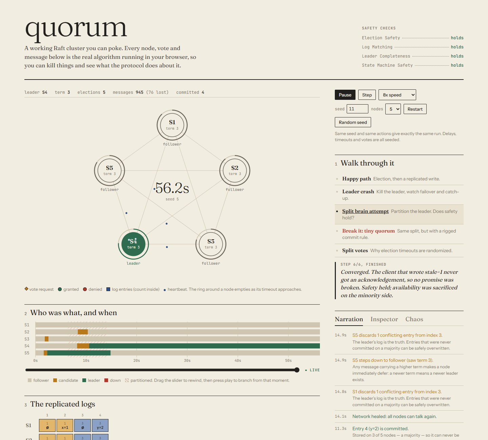
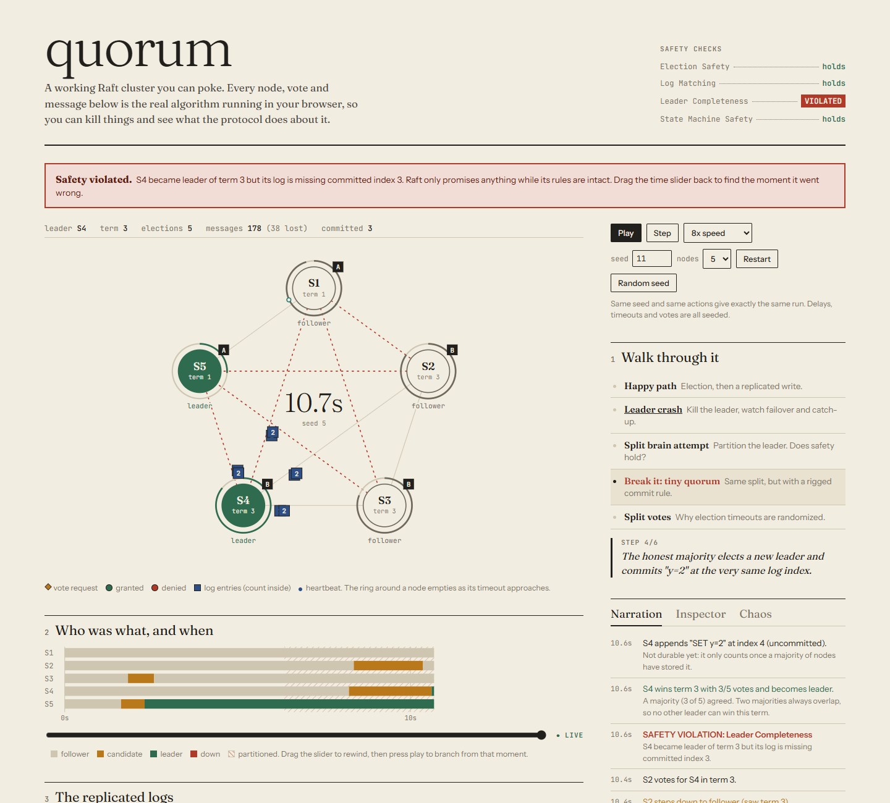

# Quorum

**An interactive Raft consensus simulator** — watch a cluster elect leaders, replicate logs, survive crashes and network partitions, and then *break the algorithm on purpose* to see why each rule exists.



Everything runs in the browser. There is no backend: the cluster is a deterministic simulation written in TypeScript, and the UI is a read-only view of its state.

## What makes it more than a visualization

| Feature | Why it matters |
| --- | --- |
| **Full Raft core** — leader election, log replication, commit rules, no-op on election, log conflict repair (`nextIndex` back-off), crash recovery with persistent vs. volatile state | Implemented from the paper (§5), not hand-animated. The picture is the algorithm's real output. |
| **Deterministic discrete-event engine** with a seeded PRNG | Same seed + same actions = identical run. Bugs are reproducible; scenarios are scripted reliably. |
| **Time travel** | The engine snapshots state every 500 ms (and on every user action). Scrub the slider to rewind, then press play to branch a new timeline from that moment. |
| **Live safety invariant checker** | Election Safety, Log Matching, Leader Completeness and State Machine Safety are verified every tick against a canonical record of everything ever committed. |
| **Fault injection** | Crash/restart nodes, partition the network into arbitrary groups, message loss, latency, election-timeout spread. |
| **"Break Raft" mode** | Disable one safety rule (commit on a minority, ignore log freshness when voting, vote twice per term). The invariant checker catches the resulting corruption and the timeline shows how it happened. |
| **Guided scenarios** | Scripted walkthroughs with narration: happy path, leader crash, split-brain attempt, split votes, and a sabotaged split-brain that loses committed data. |
| **Fuzz-tested** | 150 random seeds × 120 simulated seconds of random crashes, partitions and loss on 3/5/7 node clusters: zero invariant violations. With the sabotage flags on, the checker catches violations. |



## Reading the UI

- **Ring around a node** drains toward its next election timeout (followers/candidates) or next heartbeat (leaders). A heartbeat resets it — watch what happens when they stop.
- **Flying shapes** are real in-flight RPCs: amber diamonds are vote requests, green/red dots are vote replies, blue chips carry log entries, small dots are heartbeats and acks. Messages dropped by loss or a partition die mid-flight with an ✕.
- **Roles over time** is a per-node swimlane. Red shading marks partitions, ♛ marks elections won.
- **Replicated logs** shows every node's log side by side. Colour = the term an entry was created in; solid = committed, dashed = not yet committed.
- **Narration** explains each event in plain English, including *why* (e.g. why a vote was refused).

## Architecture

```
src/engine/            pure TypeScript, no React, no DOM
  raft.ts              Cluster: Raft state machine, network model, chaos API, invariant checker, snapshots
  scenarios.ts         scripted, condition-driven scenarios (steps wait for "stable leader", etc.)
  fuzz.ts              random fault-schedule generator used by the tests
  raft.test.ts         unit + determinism + time-travel + 150-seed fuzz + sabotage detection
  scenarios.test.ts    every guided scenario runs headlessly to its promised outcome
src/useSim.ts          requestAnimationFrame loop that advances the engine at N× speed
src/ui/                SVG cluster, timeline, logs table, side panels — all pure views of engine state
```

Design decisions worth noting:

- **State is plain data** (`structuredClone`-able), which makes time travel, determinism tests and snapshot diffing trivial.
- **Message fate is decided at send time** (`ok` / `lost` / `blocked`) so the animation can show exactly where a message dies, while delivery still re-checks the partition.
- **The checker keeps a canonical committed log**: any node committing a different entry at an index already committed elsewhere is a State Machine Safety violation. Leader Completeness is checked at the instant of each election.
- **No "check quorum"**: a partitioned leader keeps believing it leads, which is what makes the split-brain scenario instructive.

Not implemented (deliberately): log compaction/snapshots and membership changes (§6, §7).

## Run it

```bash
npm install
npm run dev        # http://localhost:5173
npm test           # engine, scenarios and fuzz tests
npm run build
```

## Reference

Diego Ongaro and John Ousterhout, *In Search of an Understandable Consensus Algorithm* (USENIX ATC 2014).
